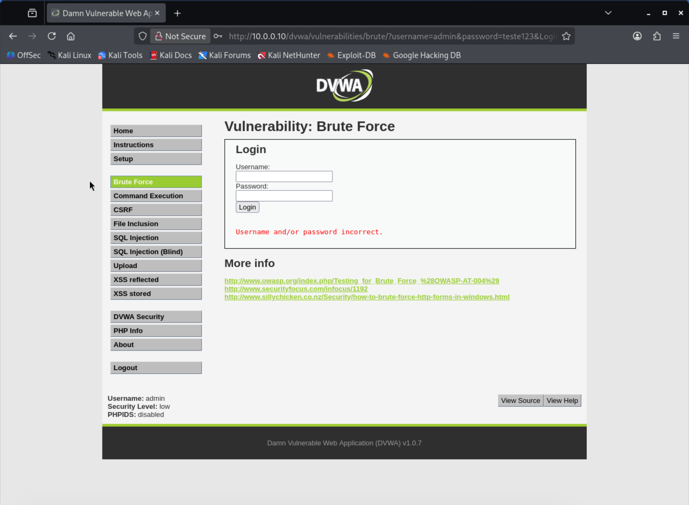
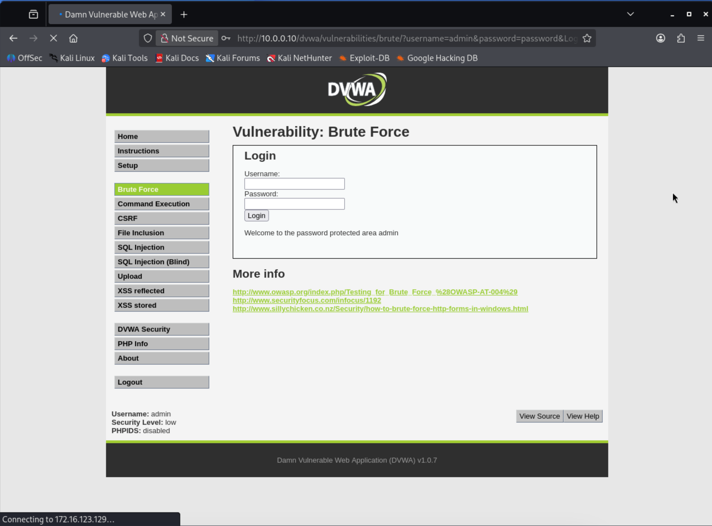

# Experimento 02 — Análise de autenticação web no DVWA

**Data:** 30/10/2026  
**Ambiente:** Laboratório virtual controlado  
**Ferramentas:** Kali Linux, Firefox e DVWA  
**Alvo autorizado:** Metasploitable 2 — 10.0.0.10

## Objetivo

Compreender o funcionamento da autenticação em aplicações web, observar as respostas apresentadas diante de credenciais válidas e inválidas e estudar os riscos relacionados a ataques de força bruta.

## Ambiente de testes

Foi utilizada a aplicação Damn Vulnerable Web Application (DVWA), instalada no Metasploitable 2, em uma rede privada destinada exclusivamente aos exercícios de cibersegurança.

A aplicação foi configurada com o nível de segurança `low`, permitindo observar o comportamento de funcionalidades intencionalmente vulneráveis.

## Metodologia

1. Acessar o DVWA pelo navegador do Kali Linux.
2. Autenticar-se na aplicação com as credenciais de treinamento.
3. Configurar o nível de segurança como `low`.
4. Acessar o módulo `Brute Force`.
5. Realizar uma tentativa manual com credenciais incorretas.
6. Comparar o resultado com uma tentativa utilizando credenciais válidas.

## Evidências

### 1. Tentativa de autenticação incorreta

A aplicação apresentou a mensagem `Username and/or password incorrect.`, indicando que a autenticação foi rejeitada.

### 2. Tentativa de autenticação correta

Foi realizada uma tentativa com as credenciais de treinamento para comparar o comportamento da aplicação diante de uma autenticação válida.

## Análise de segurança

O experimento demonstra a importância de mecanismos de proteção contra tentativas repetidas de autenticação.

A apresentação de mensagens genéricas reduz a exposição de informações sobre contas, mas não é suficiente para impedir ataques automatizados.

## Recomendações de mitigação

- Implementar limitação de tentativas de autenticação.
- Monitorar tentativas repetidas e comportamentos suspeitos.
- Utilizar autenticação multifator quando aplicável.
- Incentivar senhas fortes e exclusivas.
- Registrar eventos relevantes para auditoria e resposta a incidentes.

## Aprendizado

Este experimento permitiu compreender melhor o funcionamento da autenticação web e a diferença entre uma tentativa válida e uma inválida.

A próxima etapa será estudar a automação de tentativas em um ambiente controlado, utilizando ferramentas de auditoria e documentando os resultados obtidos.
