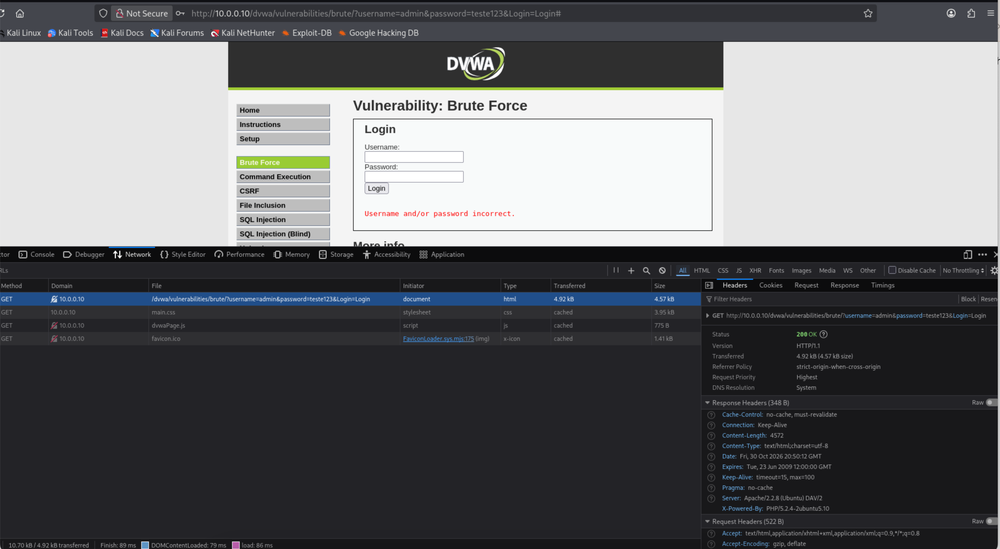
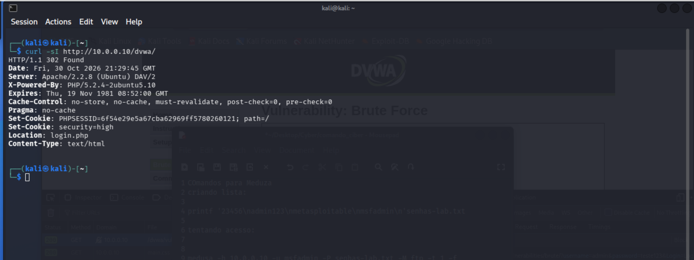
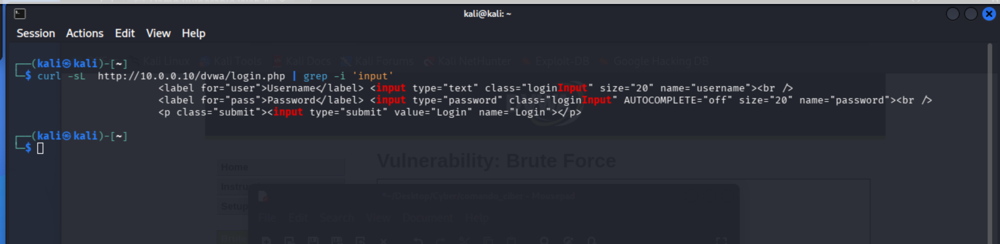

# Experimento 03 — Análise de requisições HTTP no DVWA

**Data:** 30/10/2026  
**Ambiente:** Laboratório virtual isolado  
**Ferramentas:** Kali Linux, Firefox Developer Tools, cURL e grep  
**Alvo autorizado:** Metasploitable 2 — 10.0.0.10  
**Aplicação:** Damn Vulnerable Web Application (DVWA)

## Objetivo

Compreender o funcionamento das requisições HTTP, identificar parâmetros utilizados em formulários web e analisar respostas do servidor durante testes controlados de autenticação.

## Metodologia

1. Acessar o DVWA no ambiente de laboratório.
2. Inspecionar uma requisição GET no módulo Brute Force utilizando as ferramentas de desenvolvedor do Firefox.
3. Identificar o código de resposta HTTP e os parâmetros transmitidos.
4. Utilizar o cURL para analisar o redirecionamento da página inicial.
5. Identificar os campos HTML do formulário de login utilizando cURL e grep.

## Evidências

### 1. Inspeção da requisição GET

Foi observada uma requisição HTTP GET no módulo Brute Force do DVWA, com parâmetros de autenticação presentes na URL.

### 2. Redirecionamento HTTP

O servidor retornou o código HTTP `302 Found`, indicando redirecionamento para `login.php`.

### 3. Identificação dos campos HTML

A inspeção do código HTML da página inicial de login permitiu identificar os campos `username`, `password` e `Login`.

## Resultados e análise

O experimento demonstrou que:

- As ferramentas de desenvolvedor permitem observar requisições e respostas HTTP.
- O código `200 OK` indica uma resposta HTTP bem-sucedida, mas não comprova autenticação válida.
- O código `302 Found` indica um redirecionamento.
- O cURL permite consultar respostas HTTP diretamente pelo terminal.
- O grep permite localizar informações específicas no conteúdo HTML.
- O módulo Brute Force do DVWA utiliza parâmetros de autenticação na URL, o que representa um risco de exposição de credenciais em históricos, registros e outros mecanismos de armazenamento.

## Recomendações de segurança

- Evitar a transmissão de credenciais em parâmetros de URL.
- Utilizar HTTPS para proteger dados durante a transmissão.
- Implementar limitação de tentativas de autenticação.
- Adotar mecanismos de monitoramento de tentativas suspeitas.
- Aplicar autenticação multifator quando apropriado.
- Evitar mensagens de erro que revelem informações desnecessárias sobre contas.

## Conclusão

O experimento permitiu compreender conceitos fundamentais de comunicação HTTP e identificar informações relevantes para uma avaliação de segurança em aplicações web.

A análise foi realizada exclusivamente em ambiente de laboratório autorizado, com finalidade educacional.
